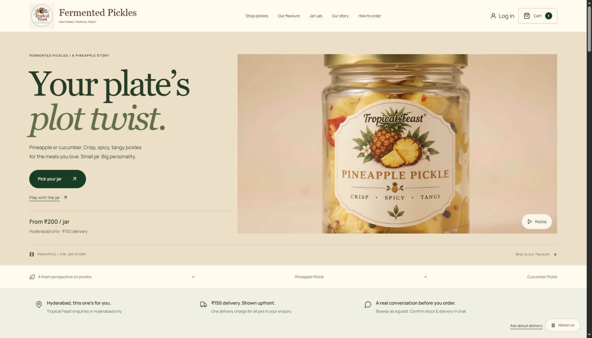
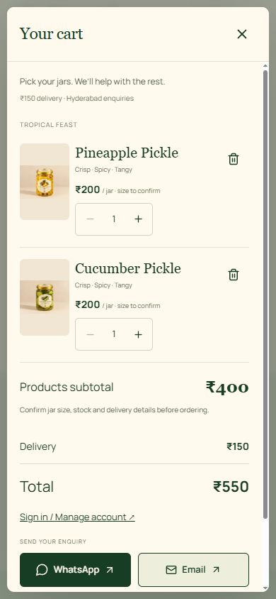

# Customer review and playful pantry upgrade

## Review from an Indian customer's point of view

What already works: real owner-supplied photos, ₹ pricing, the two confirmed flavours, a persistent illustrated guest cart, WhatsApp/Gmail enquiry links, clear quantity controls, account entry, privacy controls and a separately protected owner catalogue panel.

Problems addressed:

- ₹150 delivery was clearest only after opening the cart. It now appears in the hero, a shopping information strip, cards and detail totals. A ₹200 jar is shown as ₹350 with delivery. The original two-jar pair is ₹550 with one delivery charge, using current catalogue prices rather than hardcoded promotional prices.
- The homepage took a long path through product storytelling before displaying shopping cards. Product choices now follow the hero and shopping information; the original flavour scenes remain below the interactive experience.
- Static product imagery offered little exploration. Cards now have a subtle mouse tilt, a real-photo quick look and a keyboard-accessible zoom dialog. No fake alternate product views were created.
- The unconnected newsletter was a dead end. Its component remains available but the homepage shows it only when its endpoint is configured.
- Jar size, stock and ingredients are still not verified. The interface keeps these gaps visible, without filling them with invented claims, reviews, stock, certifications, delivery dates or payment promises.
- Re-running metadata generation could preserve previously generated tags in the template. It now strips prior canonical/social/structured metadata and noscript content before generating page-specific output; tests check a single canonical and JSON-LD block.

## Visual direction and inspiration

Warm cream, muted sage, pineapple gold and deep olive. Larger serif product names, restrained borders, photo-led cards, readable delivered totals, tactile controls and more conversational copy. Original brand, photography, hero film, cart, auth, owner APIs and archived fruit routes remain.

21st.dev research: [Product Image Card](https://21st.dev/@ruixen.ui/components/product-image-card), [Presence Card](https://21st.dev/@ravikatiyar162/components/presence-card), and range-slider patterns. These informed the image viewer, light pointer tilt and explicit slider controls. The components were written for the existing project; no registry source or unnecessary UI library was installed.

## Jar Lab

The original 1280 × 720, 24 fps local film was inspected again. The lid is raised at 6.5 seconds and seated at 7.5 seconds. Openness from 0–100 maps continuously to video time 7.5–6.5 seconds. Dragging up lifts the lid; down closes it. Pointer capture, cancellation, a labelled native range slider, explicit open/close and reset buttons provide complementary controls.

The second video element is created only after an intentional interaction, uses the same cached local MP4, never autoplays, and reuses the existing seek-coalescing controller. The hero remains inline autoplay with pause and offscreen behavior. No scroll pinning or hijacking was added. Reduced motion and the site pause control use original still frames instead; loading/error states preserve a matching poster and a usable still-frame fallback. Both new WebP posters are direct extractions of the supplied footage, not generated product images. The recording's camera movement and source framing remain; this is a reversible video interaction, not a fabricated 360-degree product model.

## Files

- `src/components/JarLab.tsx`, `src/lib/jarInteraction.ts`: lid interaction, keyboard/touch controls and fallback.
- `public/videos/jar-sealed.webp`, `jar-lifted.webp`: original footage stills.
- `src/components/ProductGallery.tsx`: photo inspection and zoom dialog.
- `src/components/ShoppingConfidence.tsx`: service area, delivery and guest ordering information.
- Existing `Pickles.tsx`, `CinematicHero.tsx`, `App.tsx`: cards, delivered totals, pair cart action, shopping order, navigation and configured newsletter rendering.
- `src/experience.css`, `src/main.tsx`: scoped visual layer and responsive styling.
- `scripts/build-pages.ts`, relevant tests: idempotent metadata generation and regression coverage.

No dependency, authentication-permission, payment, product-data or secret changes were needed.

## Verification and limitations

61 automated tests pass, including continuous/reversible drag mapping, pointer/range controls in reduced motion, photo zoom/focus restoration and the pair cart action. Frontend/server TypeScript, build and format checks are included in `npm run verify`. Live browser checks and screenshots are recorded after deployment. Phone CSS uses a single-column product grid, a stacked Jar Lab, large native/touch controls and no hover dependency; the live site has now been checked at 320 px and 390 px phone widths, 768 px tablet, 1024 px laptop, and the default 1680 px desktop viewport. These are responsive viewport checks, not physical-phone hardware tests.

## Owner information still needed

The next trust improvements need real business information, not decorative widgets: exact net jar sizes, ingredients and allergens, shelf-life/storage directions, seller/legal identity and address, delivery coverage and usual lead time, accepted payment methods, tax treatment and clear cancellation/refund/support terms. Add only verified reviews, with permission, once they exist. Clerk production setup and a real owner-session upload/save test remain pending from the previous update. No COD, UPI checkout, payment success, pincode delivery guarantee or order tracking is claimed by this enquiry-based store.

## Live browser verification — 25 October 2026

The code deployment reached READY on Vercel. Native mouse dragging changed the Jar Lab from 0% / 7.5 seconds to 100% / 6.5 seconds; reverse dragging passed 50% / 7 seconds and returned to 0% / 7.5 seconds. The video stayed paused throughout and followed pointer control rather than autoplaying. The native range and open/close controls remain alternatives.

The product photo dialog opened at phone width, and its zoom changed the rendered photo from its container width to 160%; closing restored the shopping view. Add both to cart produced the ₹400 subtotal + ₹150 delivery = ₹550 total at phone width with both contact buttons visible. Only the test-added pineapple item was removed afterwards, preserving the pre-existing cucumber basket item. No enquiry message or payment was sent.

No horizontal overflow was observed at 320, 390, 768, 1024 or 1680 pixels. Visual review led to focused refinements: sticky-header anchor spacing, a more compact phone catalogue introduction, an expandable menu on portrait tablets, and moving the phone motion toggle below the footer so it cannot cover shopping buttons. The existing motion controls and cookie preferences remain.

The production build, frontend/server TypeScript, 61 tests and formatting pass. Metadata generation was also run twice; the targeted SEO/commerce checks passed with one canonical and JSON-LD block per indexable page. Development startup succeeds with `npm run dev -- --host 127.0.0.1` in this environment; the standard all-interface startup hits an environment network-interface restriction. Live-browser verification used the deployed site rather than claiming local HTTP access.

## Screenshots

