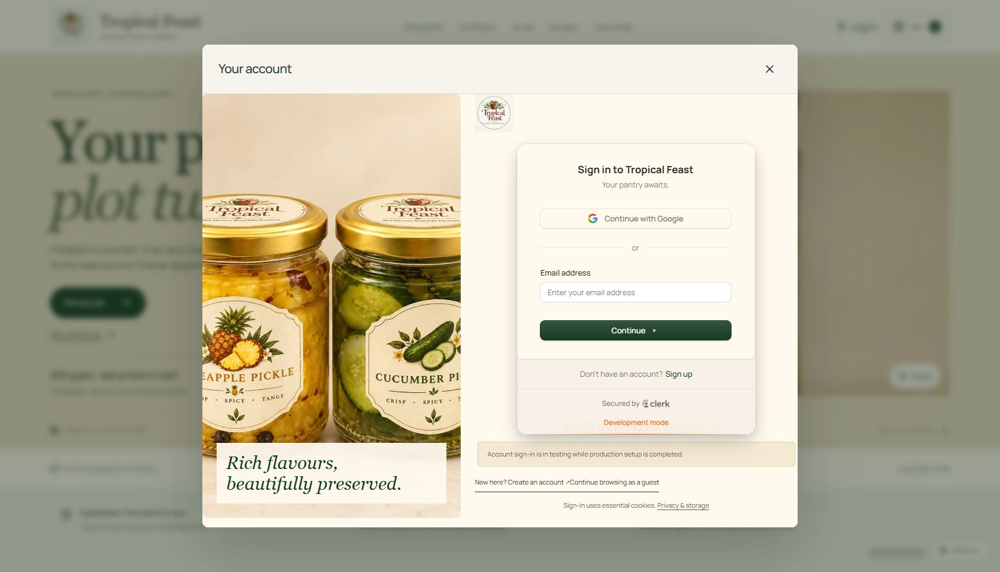

# Live release — 25 October 2026

- Site: https://fruty-fawn.vercel.app
- Repository: https://github.com/krishna3251/fruty
- Application commit: `4dba89cf8a59e8c594af1dfa9e48b97743c6319f`.
- Production main deployment: `dpl_62ZJt1aMDRMsW9dbBkNo726WLK8x`, READY. An earlier production build of the same application was `dpl_BFJHsrASWtaWoC7UXAJxw3nWpsrB`, also READY.
- Framework: existing React/Vite; the final main build command remains `npm run build`.

## Login verification

The homepage automatically displayed the real Clerk login dialog after Clerk finished initializing for a signed-out visitor. Google and email controls were visible. Continue browsing as a guest closed it; the header login button reopened it. The dedicated `/sign-in` destination also loaded the real Google/email interface. Its HTTP response was 200 with `Cache-Control: private, no-store` and `X-Robots-Tag: noindex, nofollow`.

The sign-out button and Clerk provider default now target `/sign-in`, so signing out does not depend on the homepage popup. Closing an authenticated account dialog no longer saves a guest-dismissal flag. A regression test covers signed-in → loading → signed-out with an old guest flag and verifies that choosing guest afterward still works.

No user was signed in, signed out, registered or sent a verification email during live checks. The actual authenticated round trip and Google OAuth completion still require the owner's test. Clerk remains a DEVELOPMENT instance and needs owned-domain production setup. Visible auth controls alone do not establish that production OAuth is ready.

The phone check used a 390 px viewport: the dialog width was 350 px without document overflow, and the sign-in route also had matching page/viewport widths. The viewport override was reset afterward. No application console errors were observed; Clerk's development-key warning remains expected. Vercel's runtime-error scan reported no errors in the selected one-hour window. These checks are not a penetration test.

## Migration execution and approval incident

The first deployment-specific migration build override did not run because the repository's explicit `vercel.json` build command took precedence. No migration was claimed from that build.

A temporary release branch changed only the build command to run the reviewed additive migration and guarded catalogue upgrade before the normal build. Creating that branch automatically triggered preview deployment `dpl_9WH7f8wk8RAQgxMhhp84z24sHCkm`. Its logs show `Applied 001_customer_commerce.sql`. The catalogue script skipped both original products as already configured and reported no legacy seed values needing upgrades; no product records were overwritten by that script.

Automatic approval review rejected the requested production bootstrap deployment as exceeding the publishing approval. The automatically triggered preview had already run its migration before cancellation could stop it. This was an unintended preview side effect of the release branch. No further database-write attempts were made after this was discovered. The temporary branch's build command was restored to the original normal build using a forward commit, so subsequent builds of that branch do not rerun migrations.

A live production GET of `/api/business` subsequently returned 200 with actual database-read output (`version: 0`, without the failure-fallback `configured: false` marker). `/api/catalogue` returned both original products at ₹149 / 200 g, revision `initial`. This proves the public settings query and catalogue read, not real customer/profile/cart/order writes. No customer enquiry was submitted and no message or payment was sent.

Project-wide automatic domain-assignment changes and cancellation of the in-progress production deployment were also rejected by automatic review. Those rejected actions made no persistent project-setting change. The approved normal application deployment completed successfully, and the main branch keeps the original build configuration. Future database changes must be separately reviewed and explicitly authorized; migrations do not run from a public endpoint or the final main build.

## Verification and remaining work

The local production build, frontend/server TypeScript, formatting and all 78 automated tests passed before publishing. Database tests used isolated PostgreSQL through a Neon-transport adapter. Live customer-data persistence, owner edits/uploads, and a completed sign-in/sign-out cycle are not claimed as tested.

Complete Clerk production/Google configuration; verify a real customer and owner session; confirm retention/backups, legal seller/address, ingredients/allergens, stock, delivery PINs/rates/timing and commercial policies. No online payment gateway was added.

