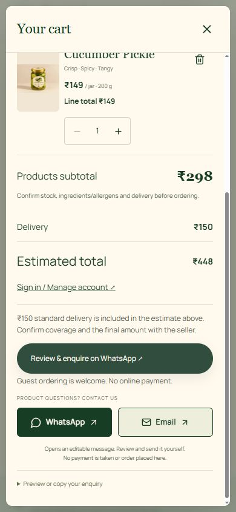

# V4 customer-experience audit and implementation

25 October 2026 · Existing `krishna3251/fruty` repository. This report supersedes historical notes describing unconfirmed standard shipping. The latest supplied V4 brief explicitly confirms **₹150 standard delivery per order**. Existing owner-configured PIN overrides/free-delivery rules remain supported. Product prices remain catalogue-driven (initial pineapple/cucumber jars: ₹149 / 200 g); no new product varieties or claims were added.

## Baseline and priorities

Inspected React 19 / Vite / TypeScript source, routing, CSS, Clerk, Blob catalogue, Neon access/migration, APIs, owner editor, consent, metadata and tests. Clean baseline `028ea65`: production build and 78 tests passed. Preserve the existing assets, cinematic autoplay hero, accessible Jar Lab, zoomable photography, routes, account carts and seller-confirmed WhatsApp workflow.

P0: verify the real sign-out destination and session handling; prevent auth/guest-navigation friction. P1: recovery, visible product prices, transparent centralized delivery, consistent feedback and accurate server snapshots. P2: delivery/support information and footer. P3: touch/keyboard/responsive refinements using existing design and motion.

## Audit checklist

| V4 requirement                           | Baseline finding                                                                                   | Implemented / verification limit                                                                                                                                                                      |
| ---------------------------------------- | -------------------------------------------------------------------------------------------------- | ----------------------------------------------------------------------------------------------------------------------------------------------------------------------------------------------------- |
| Design system / visual hierarchy         | Warm existing branding and original photos work; prices hidden on listing cards                    | Preserved; product photo/name/price/200 g/Add to cart now visible; pair price explicit                                                                                                                |
| Responsive layouts                       | Existing responsive CSS; phone input zoom and modal height needed attention                        | 16 px mobile fields, dynamic viewport dialog height, safe-area padding, restrained toast position; browser results below                                                                              |
| First-visit login / restoration / logout | Session-aware popup and `/sign-in` logout already implemented                                      | Retained; real previously authenticated browser restored its account, then real Sign out displayed signed-out Google/email UI. Signup/Google completion not newly executed                            |
| Login / signup UI                        | Real Clerk controls and loading/error fallbacks already present                                    | Kept Google/email/password/signup. Explicit guest exit now records dismissal on account pages, avoiding reopening the welcome on the next shop route                                                  |
| Password recovery                        | No visible recovery link in actual live combined sign-in form                                      | Added visible Forgot password, email prefill in memory, provider-backed code verification/new password, show/hide, cooldown and truthful errors/success. Real email delivery/reset needs owner test   |
| Authentication security                  | Clerk verifies server identity; no local preference is authentication                              | Preserved. Clerk owns hashing/sessions. Local recovery never stores passwords/codes. Additional verification returns to provider UI                                                                   |
| Toasts                                   | Mixed local status messages; no shared toast surface                                               | One lightweight context supports success/error/warning/info, bounded deduplicated stack, screen-reader announcements, dismissal, cart action, offline/reconnect; important form errors stay inline    |
| Inline validation / alerts               | Existing forms validate; provider/API errors retained                                              | Preserved; recovery errors/codes/password policy and bounded optional delivery instructions added                                                                                                     |
| Cart item presentation                   | Real images, variant, unit price, quantities/removal present                                       | Added line totals; unpriced/unavailable items cannot start checkout; no ₹0 price invented                                                                                                             |
| Cart quantity / persistence              | Guest storage, signed-in Neon cart, optimistic revisions, idempotent merges work in isolated tests | Preserved; stock/99-jar warnings. Add is intentionally idempotent; quantity controls explicitly add more jars                                                                                         |
| Delivery / total                         | Previous brief left delivery unconfirmed                                                           | ₹150 centralized fallback; owner area rules still work. Cart shows standard estimate before address; address review/server use PIN-specific rule if configured                                        |
| Empty cart                               | Working real-product suggestions                                                                   | Preserved; no placeholder product photography                                                                                                                                                         |
| Add to cart / access                     | Header badge, cart drawer, details actions already work                                            | Preserved; success toast and View cart action, prices on cards                                                                                                                                        |
| Mobile cart                              | Existing photo drawer and touch controls                                                           | Added line totals, sticky checkout entry and safe-area padding; no swipe-only removal                                                                                                                 |
| WhatsApp checkout                        | Guest details/review, server price snapshots, deduplication, unsaved fallback already present      | Adds ₹150 delivery estimate and total to persisted snapshot/draft; instructions, line totals, explicit Copy order request. Opening WhatsApp never sends, clears cart, confirms order or marks payment |
| Homepage / video / Jar Lab               | Supplied MP4 autoplay, poster/retry/reduced-motion, optional drag/keyboard jar already work        | Preserved; clarity/fee/price copy refined. No replacement media or unsupported ingredients/reviews                                                                                                    |
| Product content                          | Ingredients, stock, storage/shelf life not supplied                                                | Remain missing/ask seller; no organic/medical/manufacturing claims invented                                                                                                                           |
| Footer / support                         | Existing real contacts and policies; shipping/support not separately accessible                    | Added `/shipping`, `/returns`, Home/Story/FAQ links and verified business hours                                                                                                                       |
| Admin dashboard                          | Server-authorized owner + secondary hash; Blob uploads/validation, products, requests/settings     | Preserved; overview counts only currently loaded filtered requests, not invented all-time revenue. Rotate previously shared secondary password via secure env setup                                   |
| Neon persistence                         | Existing additive tables/functions/constraints/versioned migration                                 | No schema change or live migration in this update. Delivery/instructions use existing numeric/JSON columns; existing records untouched                                                                |
| Cookies / privacy                        | Essential Clerk sessions, guest preferences/cart, opt-in optional analytics already separated      | Preserved. No new analytics or advertising providers; consent is never auth proof                                                                                                                     |
| Performance / a11y / QA                  | Local fonts/images, lazy routes, reduced motion, modal focus trap, security headers/tests present  | No new dependency. Preserve keyboard routes and improve touch fields; actual field Core Web Vitals/WCAG certification not claimed                                                                     |

## Changes and important paths

- `src/components/PasswordRecovery.tsx`: Clerk Core 3 code-based recovery and separately testable form; provider is reused, not a second password database.
- `src/components/ClerkAccount.tsx`, `AccountPage.tsx`, `src/context/Session.tsx`, `src/hooks/useRoute.ts`: recovery entry/prefill, explicit guest dismissal, real-session feedback and preserve Clerk-owned hash navigation.
- `src/context/Notifications.tsx`, `src/main.tsx`, `src/context/PickleSelection.tsx`: shared notifications and real cart feedback.
- `src/lib/business.ts`, `src/lib/customer.ts`, `src/lib/catalogue.ts`, `server/commerce.ts`: single ₹150 default, retained PIN overrides, server-derived enquiry estimates, safe bounded instructions. Idempotency preserves original request snapshots on retry.
- `EnquiryList.tsx`, `EnquiryReview.tsx`, `AddressFields.tsx`, `CustomerDashboard.tsx`: line totals, pre-checkout fees, details/review/copy/failure states; estimated amounts never mislabeled as confirmed.
- `Pickles.tsx`, `ShoppingConfidence.tsx`, `App.tsx`, `commerce.css`: product hierarchy, readable fees, existing visual identity, responsive interaction refinements/footer.
- `ServicePolicy.tsx`, `InformationPage.tsx`, `src/lib/seo.ts`, `scripts/build-pages.ts`, `server/productPage.ts`, `vercel.json`: genuine shipping/support pages, metadata/sitemap/static route coverage, consistent terms/noscript pricing.
- `OwnerOperations.tsx`, `AdminPanel.tsx`: honest overview and standard fee information.
- `Resilience.tsx`: correct active brand and accurate guest/account storage fallback.
- `tests/store.test.ts`, `tests/customer-commerce.test.ts`, `tests/admin.test.ts`: meaningful changed recovery, toast, authoritative-delivery/instructions and existing cart regressions.

## Database and environment

**No new migration, database connection, live test enquiry, account signup, uploaded photo or owner setting write in this update.** New enquiries now snapshot configured delivery estimates in existing `delivery`/`total` columns; `status=enquiry_initiated` and `payment_status=unpaid` remain unchanged. Only the authenticated seller can confirm them. Existing historic rows are not modified.

Existing environment names (values must stay private): `DATABASE_URL` (or server `POSTGRES_URL`), `CLERK_SECRET_KEY`, `NEXT_PUBLIC_CLERK_PUBLISHABLE_KEY` or `VITE_CLERK_PUBLISHABLE_KEY` (public key only), `ADMIN_EMAIL`, `ADMIN_PASSWORD_HASH`, `BLOB_READ_WRITE_TOKEN`, `VITE_PUBLIC_SITE_URL`. Optional: `VITE_GA_MEASUREMENT_ID`, `VITE_NEWSLETTER_ENDPOINT`; unused if unconfigured. No new credential required.

Clerk production instance/domain/Google settings and password/email strategies must be configured in the provider. Clerk's actual integration uses emailed **codes**, rather than inventing a link-token endpoint. Complete real recovery/signup/email delivery tests using an owner-controlled account. The app never claims mail was delivered just because a request button was clicked. Provider errors and additional factors do not bypass authentication. Password policy enforced by Clerk, with basic client guidance.

Previously shared panel credentials require rotation by the owner using the documented salted server hash setup; no replacement secret is printed or committed. Public email/WhatsApp remain configured verified contacts, hidden behind action links. Legal seller/address, ingredient/allergen information, stock, storage/shelf life, tax/payment arrangements, service PINs/timing, cancellation/refund terms, retention and backups still require owner confirmation.

## Verification

Baseline: 78 tests, strict frontend/server TypeScript and production build passed.
Changed-behaviour automated suite: 83 tests passed, including actual parameterized production SQL through isolated PostgreSQL transport, recovery provider mocks (no email/password changed), duplicate submission guards, expired code/weak password/network failures, notifications, delivery estimates and account isolation. Production build/format results and browser release checks are recorded in the release follow-up below.

Real pre-release browser observation: an existing authenticated session restored the customer account and its saved cart. Clicking Sign out ended that session and displayed the actual signed-out Google/email/password form at `/sign-in`; no customer credentials were entered. This verifies restore/logout UI, not a fresh Google/sign-up/recovery round trip.

Sources consulted: [Clerk Core 3 recovery guide](https://clerk.com/docs/guides/development/custom-flows/authentication/forgot-password) and installed `@clerk/react` 6.18.1 types. No new third-party component library or tracking was added.

## Release follow-up

Application commit `bfefac1` was published on GitHub main and production deployment `dpl_BPKpBhVfy5QCbSbZ4srrbEPagQ4g` reached READY. The site remains https://fruty-fawn.vercel.app. No deployment build/migration command or project setting was changed.

Live browser checks on the V4 release: home, shop and cart at 320, 375, 390, 430, 768, 1024 and 1440 px without horizontal overflow. Both shop photos loaded, listing prices/sizes were correct, a pair totalled ₹448 including delivery; increasing pineapple to two made ₹597 and decreasing restored ₹448. Guest cart survived refresh and the dismissed welcome did not recur. The first-visit login and mobile recovery entry opened. Shipping/returns returned HTTP 200 with unique metadata; an unknown route returned an actual HTTP 404.

The release check identified and corrected two follow-ups: the live API sitemap had its own route list that omitted new policies (now shares the canonical route helper, with regression coverage); Clerk's separate React root did not deliver the typed email through the parent change listener (now reads only the email input on the explicit Forgot password action). Also corrected policy noscript content/breadcrumbs, suppressed background toasts while a modal is open, retained guest choice in provider-failure exits and made the hero price/delivery note catalogue-driven. Final correction deployment/browser recheck is reported with the final response. Local verification remains 83 tests, production build/type checks and formatting.

These viewport checks do not establish physical-device keyboard/slow-network behavior, field Core Web Vitals, WCAG certification, a new OAuth/signup round trip or actual recovery email/reset. No message, payment, genuine enquiry or privileged owner write was performed. Real recovery delivery, production Clerk setup, owner credential rotation and the missing business information remain outstanding.

